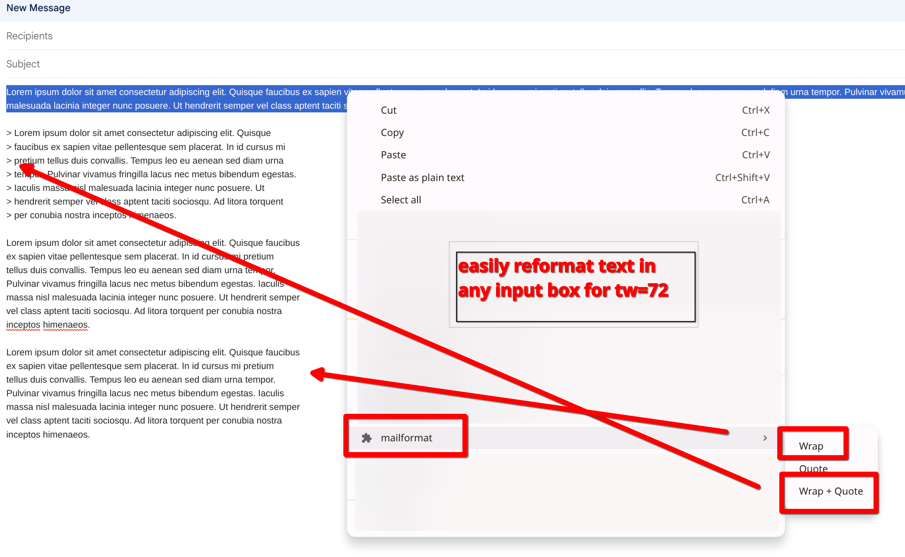

# chrome-mailformat

Chrome extension for reformatting text in any text input box in mailinglist style (line length: 72 characters, quote).

Select text in any text box, right-click -> **mailformat**:

- **Wrap** — hard-wrap to the text width, keeping existing line breaks
  (quoted lines keep their `>` prefix)
- **Quote** — prefix every line with `> ` (`>>` for already-quoted lines)
- **Wrap + Quote** — wrap, then quote; lines stay within the text width

Text width defaults to 72 and can be changed in the extension options.

## Install

1. Open `chrome://extensions` and enable Developer mode.
2. Click **Load unpacked** and select this directory.

## Screenshot

